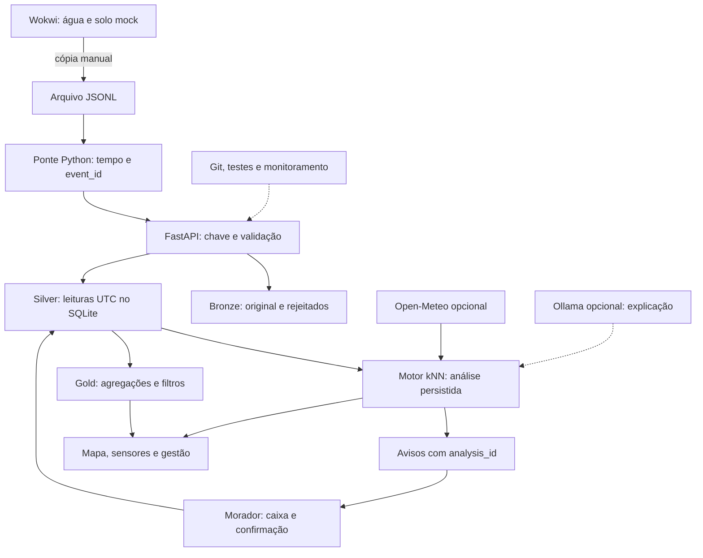

# Arquitetura AlertaRio v2

As leituras são simuladas e identificadas; o replay não é rede direta do Arduino virtual. Bronze guarda original autenticado e resultado do tratamento; Silver e análises ficam no SQLite; Gold é materializável em JSON/CSV e servido pela mesma API do dashboard. O backend serve frontend/ no mesmo domínio, com cookie de sessão e CSRF.

O motor cria uma análise por ingestão, usa previsão em cache quando disponível e gera aviso em mudança de classe. Atualizar com previsão é um POST de gestor e cria outra análise persistida. A caixa do cidadão consulta a cada 5s e confirma o ID mostrado. O histórico dos avisos não usa o risco atual para reescrever classes passadas.

A conexão Ollama é de explicação da análise, não de decisão ou comando operacional. Mensagens externas são extensão por script com habilitação e destinatário autorizado; não são requisito para o aviso interno funcionar.
